# ScoreRehearsal 🎶

**Your MuseScore scores, ready for rehearsal. Tap, play, sing.**

You wrote the arrangement in MuseScore. Now the choir is waiting, you're sitting next to your
laptop or tablet, and everything has to happen _fast_: "Altos, from bar 17 please!" – "Once more,
just the men!" – "What's our starting note?"

ScoreRehearsal is made for exactly this moment. It opens your MuseScore files (`.mscz`, `.mscx`)
and turns them into a rehearsal player: no editing tools, no menus to dig through, and no risk of
moving a note by accident. Your score stays exactly as it is. Promise.

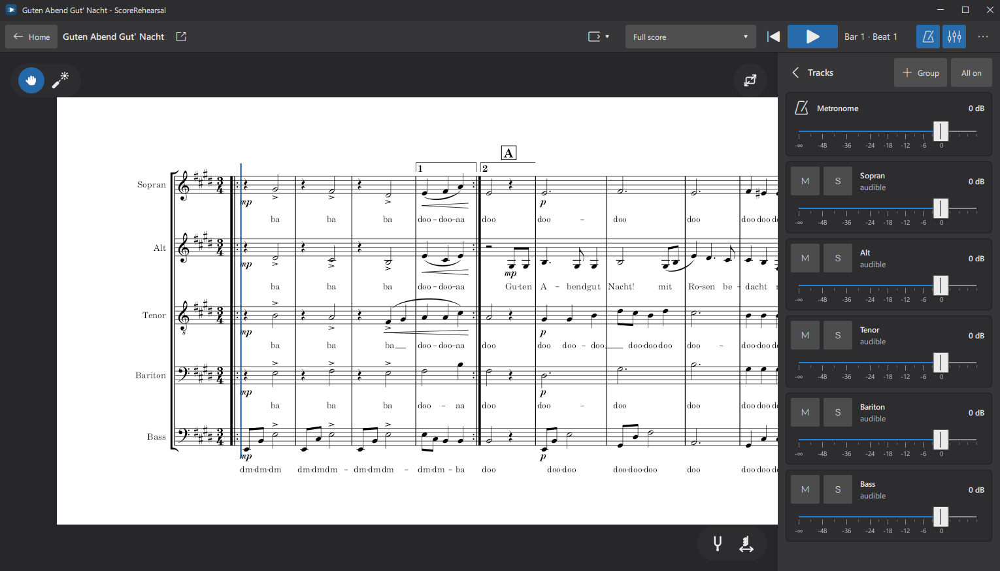

## Why you'll love it

- **Made for fingers.** Tap a note and playback starts right there. Big buttons, swipe faders,
  full screen. It works great on a touch laptop or a Windows tablet at the piano.
- **Hands off your score.** ScoreRehearsal never saves anything into your file. No autosave, no
  "Save changes?" pop-ups, no surprises the next time you open it in MuseScore.
- **Feels like home.** It uses the same engine and the same sounds as MuseScore, so your score looks
  and sounds just like you know it.
- **Remembers your rehearsal.** Your mix, your panning, your groups, the part you looked at, the bar you stopped
  at, even your markings: everything is waiting for you the next time you open the score.
- **Quiet and private.** No account, no cloud, no internet connection needed.

## Everything a rehearsal needs

### Tap and play

Tap anywhere in the score and the playhead jumps there. Hit play and off you go, right from that
beat. Switch between the familiar page view and a continuous view that scrolls along with the music.
The metronome is just one button away, with its own volume fader.

### Your mixing desk for every voice

Every voice gets its own fader, plus **M** (mute) and **S** (solo). Want the sopranos to hear their
line loud and clear, but still with the harmony around them? Put them on solo and use the
**Accompaniment** fader to decide how loud "the rest" should be. One tap on **All on** and
everybody is back.

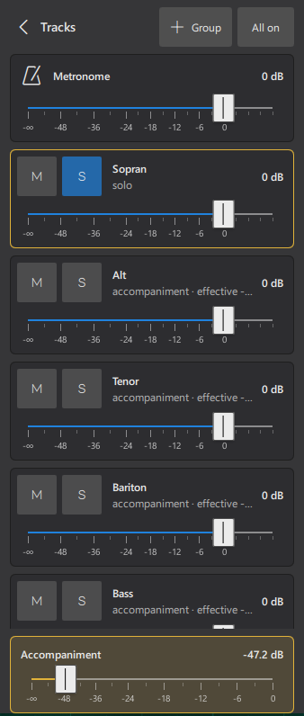

### Group voices together

Too many faders in your session? Group them together to control them with a single fader –
or put the whole group on solo.

  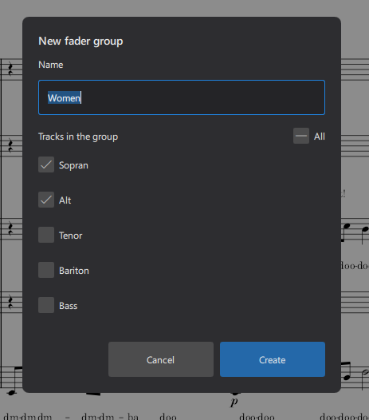
  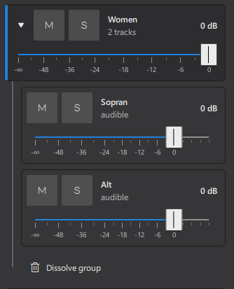

Open fader groups at any time to have control over the details.

### Place every voice in the room

Switch the tracks sidebar from **Volume** to **Pan** and every voice gets a slider to move it
between the left and the right speaker. The sliders look different from the volume faders, so you
always know which mode you are in. Tap or swipe to place a voice, double tap its value to return
to the position stored in the score, and **All centered** puts everybody back in the middle.

### Parts at your fingertips

If your score contains parts, pick one from the list at the top and see just that part. And if you
like, ScoreRehearsal plays only the voices of that part, too.

  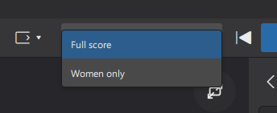
  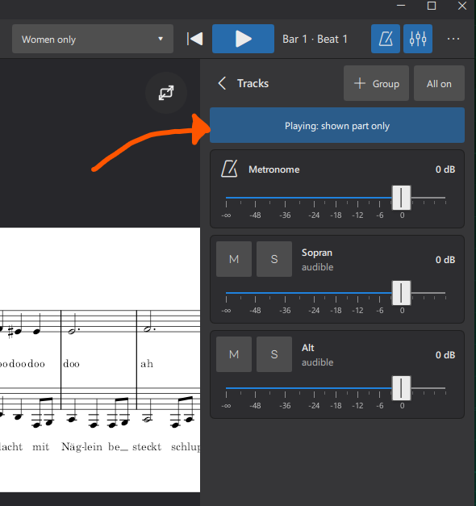

### Find the starting note – or the chord _(new in 1.1)_

Two little helpers sit at the bottom right of the score:

- **Pitch pipe:** touch a note and you hear it, for as long as you hold it. Slide your finger along
  the line and the notes sound one after another.
- **Chord scrubbing:** touch the score and you hear the whole chord at that spot. Slide left or right
  and the harmony follows your finger. Perfect for "Let's find our place in the chord".

A small hand shows you which notes are sounding right now.

  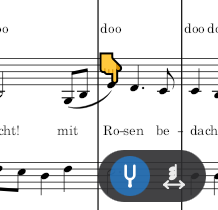
  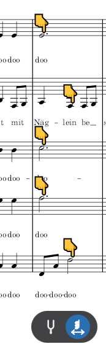

### Point, mark and draw _(new in 1.1)_

"Look here, everybody!" The laser pointer frames a spot in the score and dims everything else.
With the pen you can draw arrows and circles right on the score, just like on a whiteboard. Your
markings are kept with the rehearsal, never in the score file itself.

  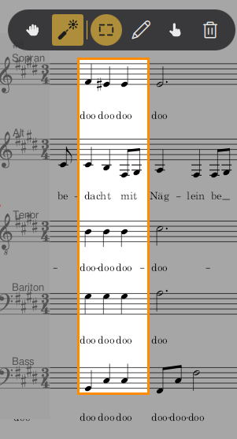
  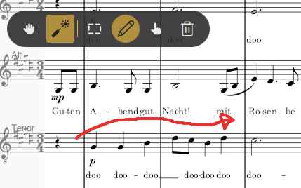

### The big screen for your singers _(new in 1.1)_

Open the presentation window on a projector or TV and the whole group can read along. The score
scrolls by like karaoke, the playhead stays in place, and your drawings show up there too.

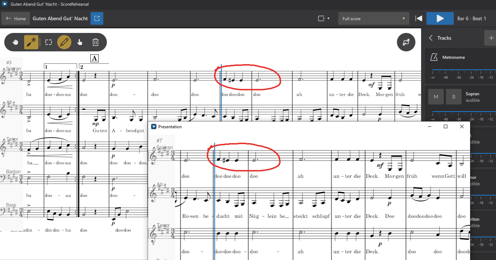

Put a voice on solo and the presentation window puts it in the spotlight: that voice stays bright,
the others are softly dimmed. Everyone knows at a glance who is singing.

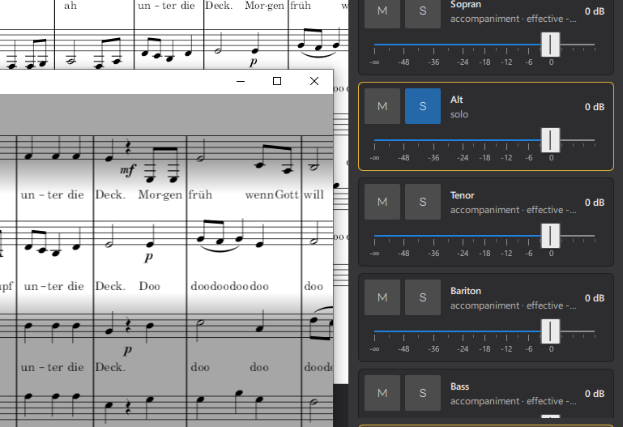

## Get started

1. Download the latest version from the [Releases page](https://github.com/coljacarls/ScoreRehearsal/releases).
2. Unzip it anywhere you like and start `ScoreRehearsal.exe`.
3. Open your MuseScore file – and start rehearsing.

ScoreRehearsal currently runs on Windows. Handy shortcuts: `Space` play/pause, `Ctrl+O` open a
score, `F11` full screen. Playback stutters? In **… → Settings** you can choose the audio device and
a larger buffer.

### "Windows protected your PC"? Don't worry.

The first time you start ScoreRehearsal, Windows will most likely show you this blue box:

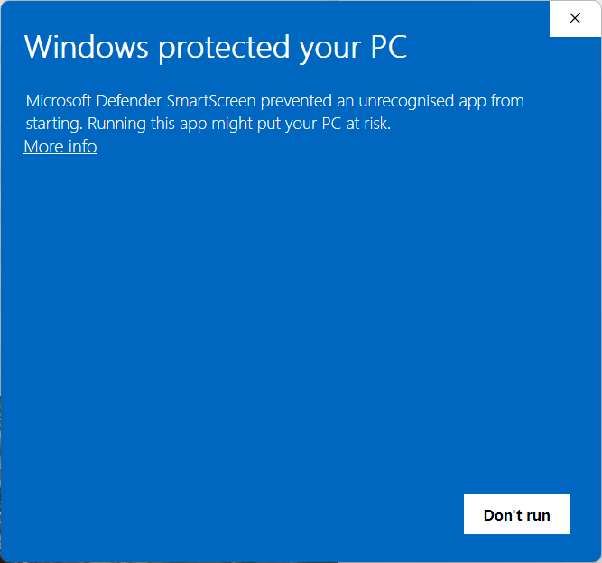

**What's behind it:** Windows warns about every app that is not _digitally signed_ and that it
hasn't seen on many PCs yet. A signature is a kind of ID card for software: a certificate that
confirms who published the app. ScoreRehearsal doesn't have one (yet), so Windows simply doesn't
know who I am. The warning says nothing about the app being harmful – and since the whole source
code is public, anyone can check what it does.

**How to start it anyway:**

1. Click **More info**.
2. Click **Run anyway**, which shows up below the app name.

That's it – Windows remembers your choice, so you only have to do this once per version.

**Why isn't it signed?** ScoreRehearsal is a spare-time project. A code signing certificate costs
money every year and means identity checks, hardware keys and extra steps for every release –
effort I'd rather put into new features for now. But there's good news: I'm currently working on
bringing ScoreRehearsal to the **Microsoft Store**. Apps from the Store are signed by Microsoft, so
the warning will be gone and installing will be a single click.

## Free and open

ScoreRehearsal is free and open source under the GNU General Public License version 3 (see
[LICENSE](LICENSE), [LICENSING.md](LICENSING.md) and [THIRD_PARTY_NOTICES.md](THIRD_PARTY_NOTICES.md)).
It is built on the code of [MuseScore Studio](https://github.com/musescore/MuseScore), but it is an
independent project and is not affiliated with or endorsed by MuseScore.

Curious how it works under the hood or want to build it yourself? Have a look at the
[developer notes](docs/DEVELOPMENT.md).

## About me and the "why"

I am a 40-something year old family father with a background in computer science and usability.
I LOVE music, love arranging it and in MuseScore I found my go-to-software, especially since [the
overhaul led by Martin Keary (aka. Tantacrul)](https://www.martinkeary.com/#/musescore-4/). Thanks for making MuseScore a no-brainer with
premium usability!

In my spare-time I often take the role of a conductor for vocal groups. Because I s\*ck at playing
the piano I tend to use the playback function of MuseScore to play the score, set the focus on
single voices, scrub through the chords to help the group find their place in the harmony.
Unfortunately MuseScore has no focus on tablets (yet) and opening a score and using it for the
porposes of the rehursal sometimes messes up the score. Everything needs to happen fast to keep
the drive in a rehursal:

- switching the playback between single voices
- starting the playback at selected measures or beats
- mixing the volume levels for certain voices in focus with "the rest"
- and everything without messing with the score underneath.

MuseScore unfortunately gave me multiple headaches in the past. Although it is the tool I always
wanted for writing scores (except for one or two things) it is very imperfect for working with the
scores the way I do during a rehursal, as my digital pianist.
This is the reason why the idea of this software exists.
When it comes to writing code, my focus is strongly on web technology and I think I won't become an
expert in C++ and Co. in the near future. My first idea was to make a pull request in the MuseScore
project for a "Rehurse" tab, right between the "Score" and the "Publish" tab. But my lack in understanding
the programming languages needed, I'd never be able to go through the process.
This is why opened this side-project with a forked MuseScore to build on.
And yes: the development is AI-first.

Feel free to use it and leave a star if it helps you. Have ideas? Start a discussion!
